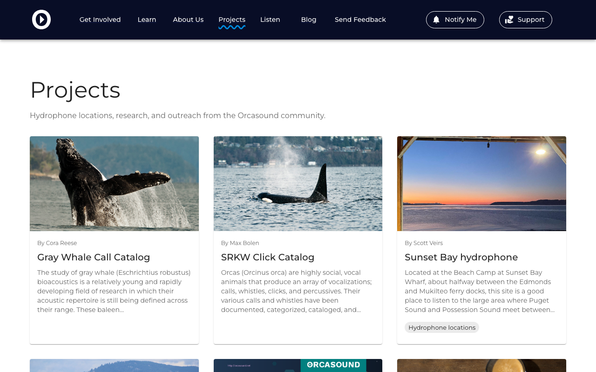
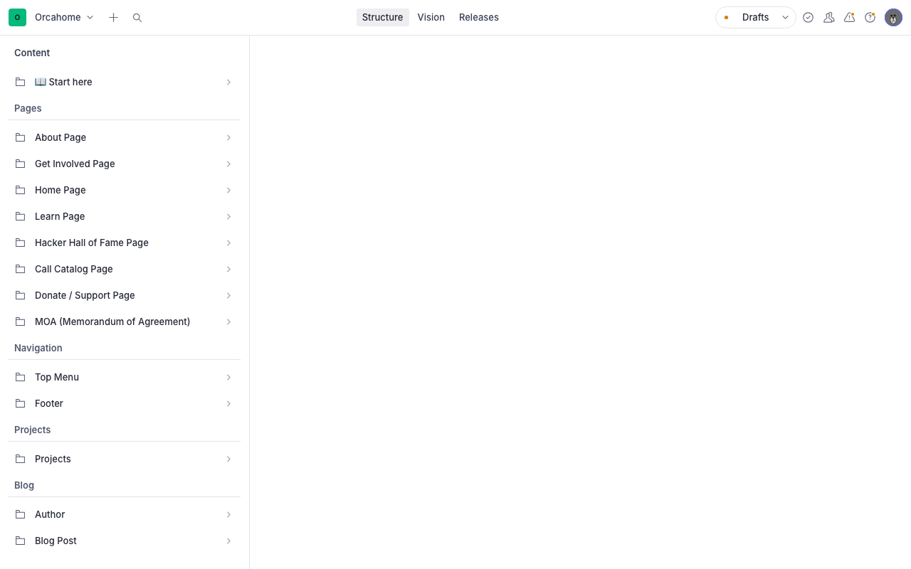
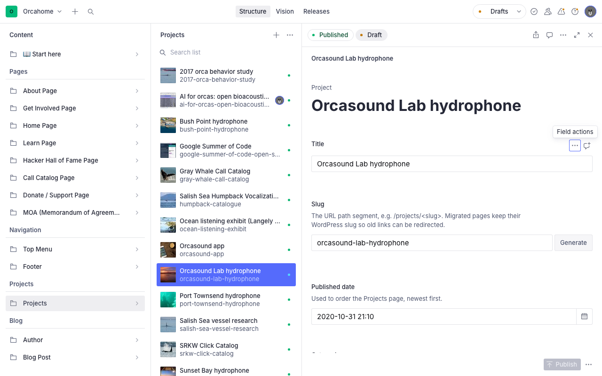
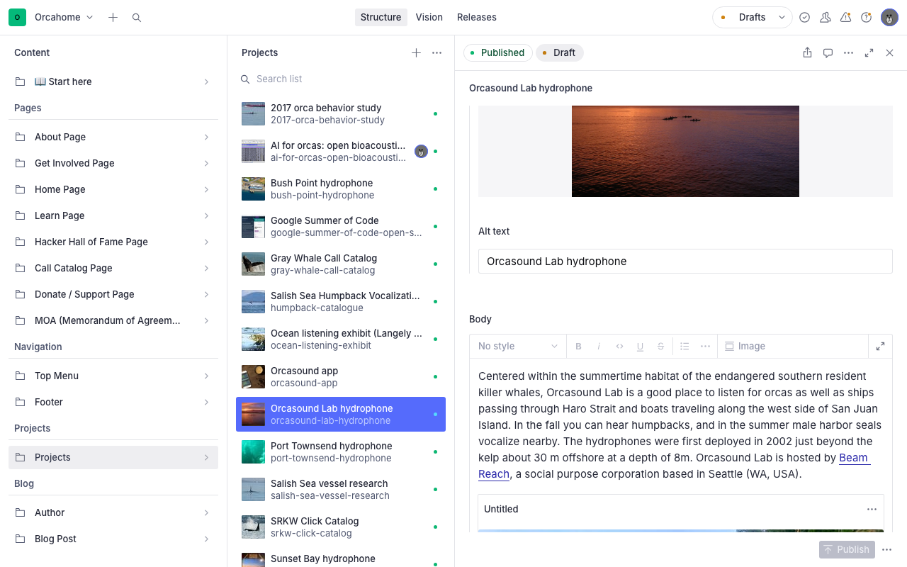
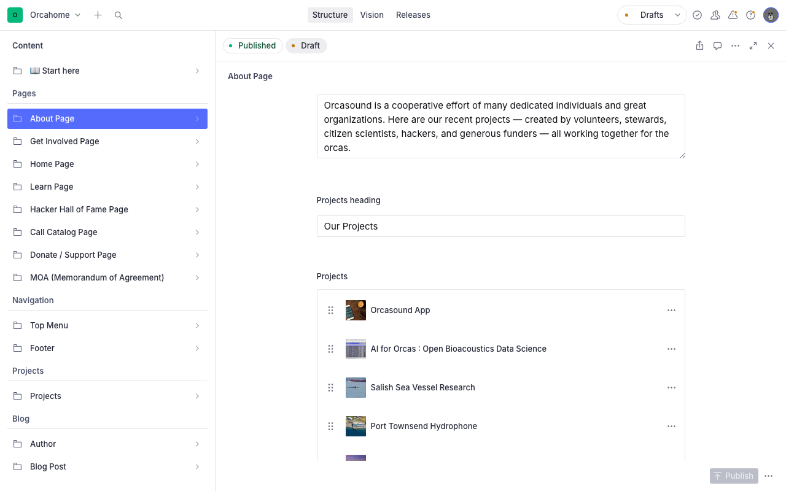

# Editing Projects (Sanity CMS guide)

This guide shows you how to add, edit, and publish **project pages** on
orcasound.tech using Sanity Studio — no code required. Projects are the
long-lived pages about what Orcasound does: hydrophone locations, research
projects, call catalogs, and outreach. They used to live on the old WordPress
site at `orcasound.net/portfolio/...`; all 13 were brought over.

Like the blog, Projects is a **collection**: you can add as many as you like.
The difference from the blog is that a project is not dated news. Its date is
only used to sort the list, and it has **categories** instead of tags.

Each project shows up in two places on the site:

- **orcasound.tech/projects** — a grid of cards, one per project, newest first.
- **orcasound.tech/projects/your-slug** — the project's own page.

---

## 1. Open the Studio and sign in

1. Go to **https://orcahome.sanity.studio**
2. Sign in with the Google account that was given access (ask an admin if you
   can't get in — ping @Vicky on Zulip).

## 2. Open Projects

In the left sidebar, under the **Projects** heading, click **Projects**.

You'll see every project. Click one to edit it.

---

## 3. The fields in a project

| Field                 | What it's for                                                                                                                                                                                                       |
| --------------------- | ------------------------------------------------------------------------------------------------------------------------------------------------------------------------------------------------------------------- |
| **Title**             | The name of the project, shown on its card and at the top of its page.                                                                                                                                              |
| **Slug**              | The web address: `orcasound.tech/projects/your-slug`. See the note below.                                                                                                                                           |
| **Published date**    | Only used to sort the Projects page (newest first). It is **not shown** to visitors.                                                                                                                                |
| **Categories**        | Little labels on the card and page. Reuse the existing ones: **Hydrophone locations**, **Research**, **Education & outreach**. Type one and press Enter.                                                            |
| **Authors**           | Who wrote or leads it. Shown as "By …" on the page. Pick existing people; see [section 7](#7-adding-an-author).                                                                                                     |
| **Short description** | Two or three sentences shown on the project's card. Keep it short; long text gets cut off with "…".                                                                                                                 |
| **Featured image**    | The card image on the Projects page only — it is **not** shown on the project page itself. If you want the photo on the page too, also add it to the Body. Wide (landscape) photos work best. Fill in **Alt text**. |
| **Body**              | The page content — see [section 5](#5-writing-the-body).                                                                                                                                                            |

> **About the Slug (the web address):**
> For a new project, click **Generate** next to the Slug field to make one from
> the title. For the 13 projects brought over from WordPress, **leave the slug
> as-is** — it matches the old WordPress address, and the About page cards
> and other pages link to it. Changing it breaks those links.

---

## 4. Add a new project

1. Click **Projects** in the left sidebar.
2. Click the **＋** button at the top of the list.
3. Fill in the fields from [section 3](#3-the-fields-in-a-project):
   - Type a **Title**, then click **Generate** to make the **Slug**.
   - Set the **Published date** (today is fine; newer projects sort first).
   - Add **Categories**, **Authors**, and a **Short description**.
   - Add a **Featured image** and its **Alt text**.
   - Write the **Body** (next section).
4. **Publish** when you're done (see [section 8](#8-publish-and-when-it-shows)).

The new project appears on the Projects page automatically. It does **not**
appear on the About page by itself — see [section 6](#6-show-a-project-on-the-about-page).

---

## 5. Writing the Body

The Body works like a simple word processor, the same as in a blog post.

- **Bold / italic**, **headings**, and **bulleted or numbered lists** are in the
  toolbar. Use headings (H2, H3) to split a long page into sections.
- **Link**: select some text, click the link button, and paste the address.
  A link to another page on this site can be just the path, e.g.
  `/projects/bush-point-hydrophone` or `/blog/your-post`.
- **Image**: click **Image** in the toolbar and upload or drag one in. To add a
  caption, type it as a normal paragraph right under the image.

### Adding an audio clip or a YouTube video

The site turns a link to an audio file or a YouTube video into a player. To add
one:

1. On its own line, paste the address — for example
   `https://example.org/clips/humpback-whup.mp3` or
   `https://www.youtube.com/watch?v=K0vmU_Jf3f4`.
2. Select that whole address, click the link button, and paste the **same**
   address as the link.

When the line is _only_ the link, visitors see just the player. If you link an
audio file from inside a sentence instead, they see the sentence with a player
under it. Audio files must end in `.mp3`, `.wav`, `.ogg`, or `.m4a`; video can
be YouTube, Vimeo, or an `.mp4` file.

> The audio in the migrated projects still plays from the old orcasound.net
> server. That's expected for now; don't remove those links.

---

## 6. Show a project on the About page

The **Our Projects** cards on the About page are a separate, hand-picked list
(so the About page can feature a few projects rather than all of them).

1. In the sidebar, open **About Page** and scroll to **Projects**.
2. To change where a card goes, click it and set **Link URL** to the project's
   path, for example `/projects/orcasound-lab-hydrophone`.
3. To add a card, click **Add item**, then fill in **Title**, **Image**, and
   **Link URL** (`/projects/your-slug`).
4. Drag the ⋮⋮ handle to reorder the cards. **Publish** the About Page.

The top menu already has a **Projects** link to the Projects page; you don't
need to add one for each project.

---

## 7. Adding an author

The Authors list is shared with the blog. If the person you need isn't there:

1. In the sidebar under **Blog**, click **Author**, then **＋**.
2. Type their **Name** (as it should appear, e.g. "Cora Reese"). Leave
   **Slug** empty or click **Generate**. **Publish**.
3. Go back to the project and pick them under **Authors**.

---

## 8. Publish and when it shows

Nothing goes live until you click the green **Publish** button at the bottom.
"Unpublished changes" means your edits are not live yet.

After you publish, the site updates **within about a minute**. Go to
**orcasound.tech/projects** and hard-refresh (Cmd/Ctrl + Shift + R). You do
**not** need a developer to deploy anything.

**To hide a project:** open it, click the **⋮** menu next to Publish, and
choose **Unpublish**. If an About page card links to it, remove or relink that
card too, or the card will lead to a "page not found" error.

---

## Troubleshooting

| Problem                                              | What's going on                                                                                                                                               |
| ---------------------------------------------------- | ------------------------------------------------------------------------------------------------------------------------------------------------------------- |
| "I published a project but it's not on the page"     | Give it ~1 minute, then hard-refresh `orcasound.tech/projects`. Check the project shows **Published** in the Studio.                                          |
| "My new project isn't on the About page"             | That's expected — About cards are picked by hand. See [section 6](#6-show-a-project-on-the-about-page).                                                       |
| "An About card goes to a 'page not found' page"      | Its **Link URL** doesn't match a published project's slug. Open the project, copy its slug, and set the card to `/projects/<slug>`.                           |
| "My audio/video shows as a plain link, not a player" | The line must be a link to the file itself (ending in `.mp3` etc.) or to YouTube/Vimeo. See [Adding an audio clip](#adding-an-audio-clip-or-a-youtube-video). |
| "The card has no picture"                            | Add a **Featured image**.                                                                                                                                     |
| "I can't sign in"                                    | Ask an admin to grant your Google account access to the Sanity project.                                                                                       |

---

_Questions or something looks broken? ping @Vicky on Zulip._
